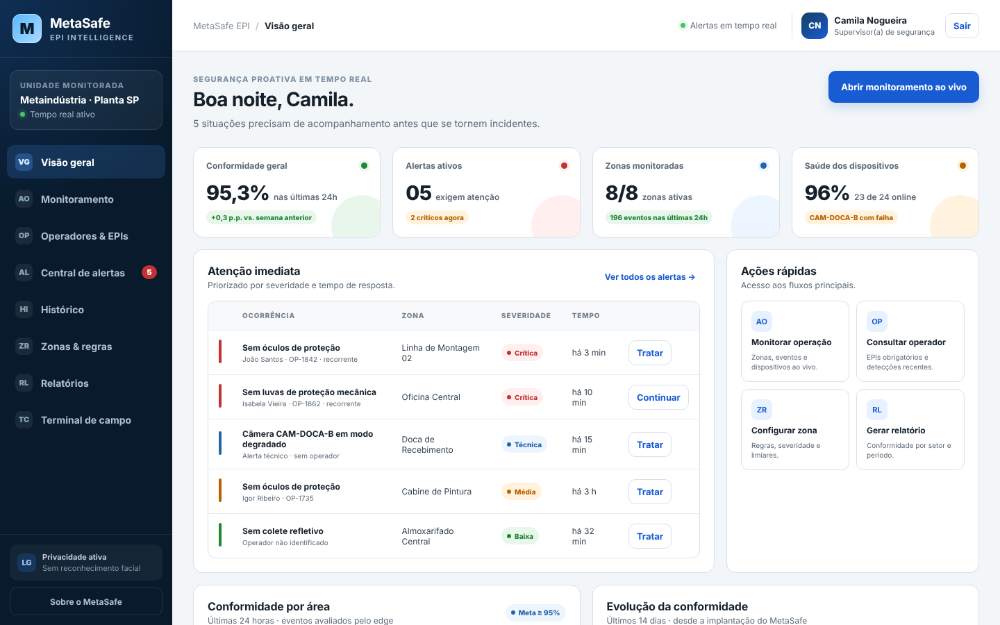
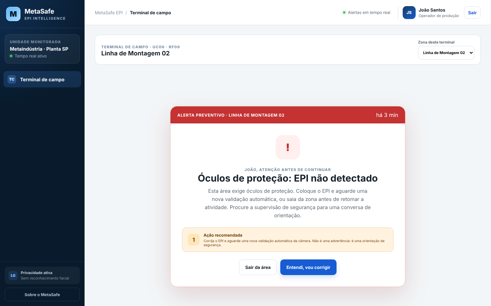
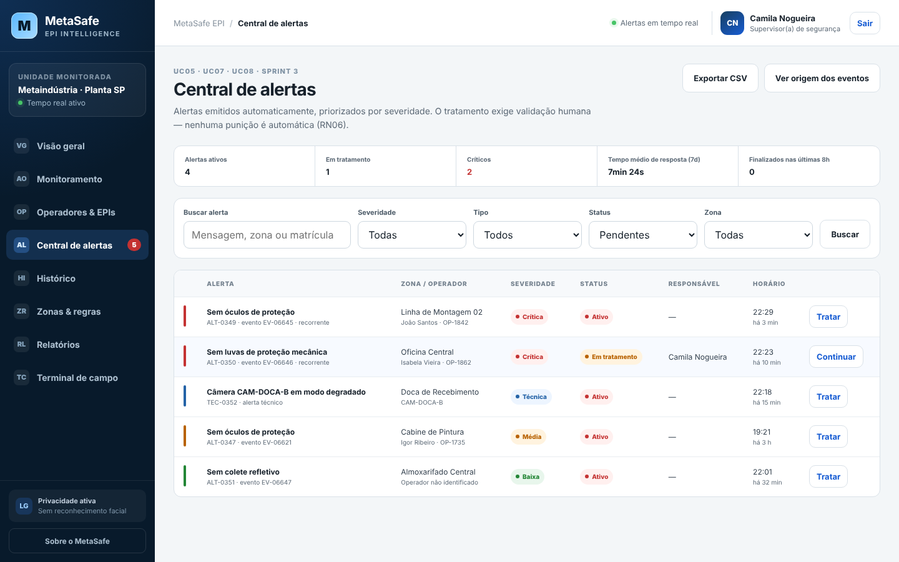
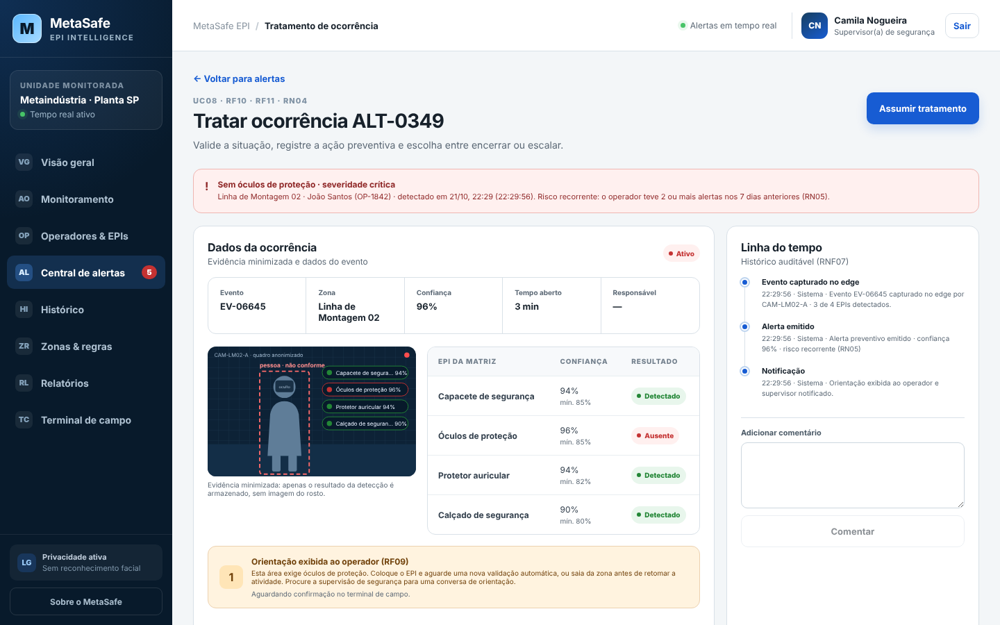
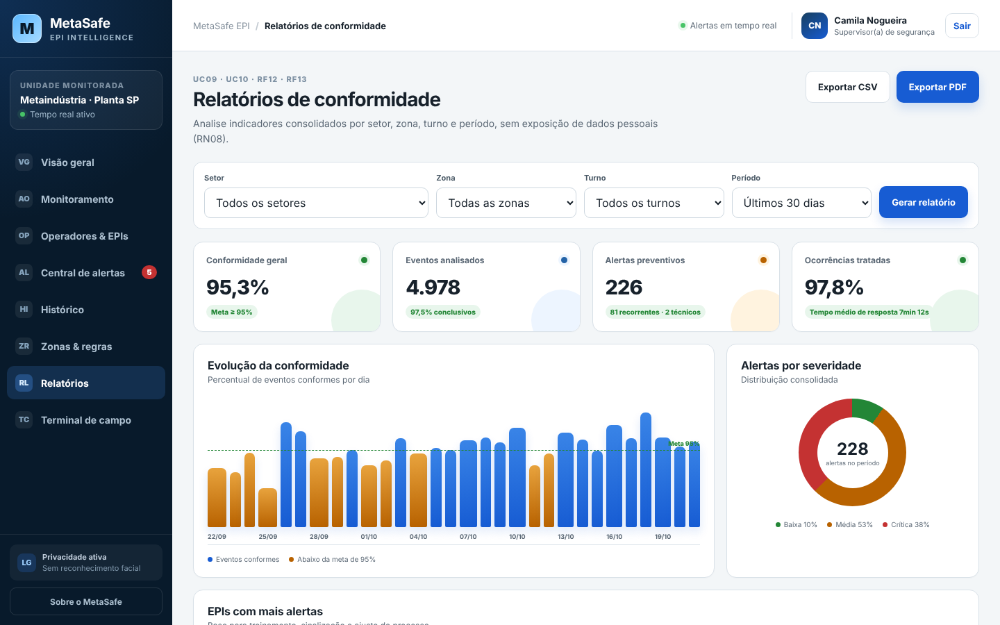
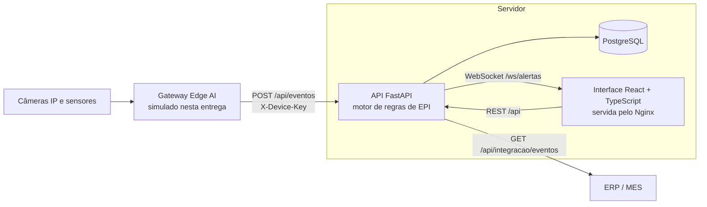

# MetaSafe EPI

**Monitoramento proativo de EPIs e riscos operacionais para a Metaindústria**
Challenge 2026 · FIAP × SPI Integração · Engenharia de Software — Sprint 4 (entrega final)



O MetaSafe EPI confere, por visão computacional no edge, se cada pessoa que entra em uma zona operacional está usando os EPIs exigidos naquela zona. Quando falta um EPI, o operador recebe uma orientação na hora, no terminal da própria zona, e o supervisor de segurança recebe um alerta priorizado em tempo real. Cada ocorrência é tratada com validação humana e fica registrada em um histórico auditável. Os gestores acompanham a conformidade por setor, zona, turno e período — **sem punição automática e sem reconhecimento facial**.

---

## Sumário

1. [Integrantes](#integrantes)
2. [Links do projeto](#links-do-projeto)
3. [Problema e proposta de solução](#problema-e-proposta-de-solução)
4. [Como executar](#como-executar)
5. [Acessos de demonstração](#acessos-de-demonstração)
6. [Roteiro rápido de avaliação (5 minutos)](#roteiro-rápido-de-avaliação-5-minutos)
7. [Funcionalidades](#funcionalidades)
8. [Arquitetura e tecnologias](#arquitetura-e-tecnologias)
9. [Testes](#testes)
10. [Estrutura do repositório](#estrutura-do-repositório)
11. [Entregas por Sprint](#entregas-por-sprint)
12. [Documentação](#documentação)
13. [Limitações conhecidas e próximos passos](#limitações-conhecidas-e-próximos-passos)

---

## Integrantes

| Nome | RM |
| --- | --- |
| Juan Alberto Lenis Rodriguez | RM559744 |
| Henrique Monteiro Khouri | RM555572 |
| Rodrigo Arantes da Silva Philippi | RM557594 |
| Celso Fernando Ferrer Singh | RM565643 |
| Kagio Miura Neto | RM559212 |

## Links do projeto

| Item | Link |
| --- | --- |
| 🎥 **Vídeo de pitch e demonstração (Sprint 4)** | `PREENCHER: link do YouTube (não listado)` |
| **Board Trello (Sprint 4)** | https://trello.com/b/5ZEjgFwj/metasafe-epi-sprint-4-entrega-final |
| Board Trello das Sprints 1–3 (histórico) | https://trello.com/invite/b/6aa9a0d60c198ec8e4172a1c/ATTI9f167e47079418fd46ba63b16020e4a10E3CC86E/metasafe-epi-sprint-3 |
| Protótipo Figma (Sprint 3) | https://www.figma.com/design/BecIXOmVPRjZ3g64rL1mkW/MetaSafe-EPI---Sprint-3?node-id=1-9&t=RzjmhqBO5sw36VXE-1 |
| Protótipo navegável (Sprint 2) | https://12345-oss.github.io/metasafe-epiSprint/ |
| Vídeo walkthrough (Sprint 2) | https://youtu.be/ylbvCCwRmCU |
| Repositório da Sprint 2 | https://github.com/12345-oss/metasafe-epiSprint |
| Repositório da Sprint 3 | https://github.com/RodrigoPhilippi/metasafe-epi-sprint3 |
| Documentação da API (com o sistema rodando) | http://localhost:8000/docs |

## Problema e proposta de solução

**Problema.** Na indústria, a segurança costuma ser reativa: a falta de EPI é percebida depois da auditoria, da não conformidade ou do quase acidente. Isso cria uma cultura punitiva — o colaborador só recebe retorno quando já errou — e deixa o supervisor sem saber quais riscos estão acontecendo agora nem quem precisa de reforço de orientação.

**Solução.** O MetaSafe EPI troca essa lógica por uma abordagem proativa:

- **Matriz de EPIs por zona** (RN01): cada zona operacional define os EPIs obrigatórios, o nível de risco e o limiar mínimo de confiança da detecção.
- **Edge AI + motor de regras** (RF04–RF07): o gateway na borda envia apenas eventos estruturados; a API compara as detecções com a matriz e calcula a severidade.
- **Orientação antes da punição** (RF09, RN05, RN06): o operador vê no terminal da zona qual EPI falta e o que fazer; o sistema diferencia esquecimento pontual de risco recorrente e nunca aplica advertência automática.
- **Alertas priorizados em tempo real** (RF08, RNF01): o supervisor é notificado via WebSocket quando a severidade é média ou crítica.
- **Tratamento auditável** (RF10, RF11, RNF07): assumir, comentar, classificar, encerrar ou escalar, com linha do tempo completa.
- **Indicadores e integração** (RF12, RF13, RF15): relatórios por setor, zona, turno e período, exportação CSV/PDF e API para ERP/MES — sem expor nomes de operadores (RN08).
- **Falha técnica separada** (RF16, RN07): câmera sem sinal gera alerta técnico para a manutenção, nunca alerta contra o operador.

**Impacto esperado para a Metaindústria.** Menos exposição a risco (o operador corrige antes de começar a atividade), resposta mais rápida do supervisor, dados confiáveis para direcionar DDS e treinamentos por zona e turno, e uma cultura de segurança baseada em prevenção. Nos dados simulados de 40 dias de operação, a conformidade sobe de cerca de 92% na primeira semana de implantação para cerca de 96–97% na última, e o supervisor leva em média cerca de 7 minutos para assumir um alerta.

## Como executar

### Opção 1 — Docker (recomendada)

Pré-requisito: [Docker Desktop](https://www.docker.com/products/docker-desktop/) (ou Docker Engine + Compose v2).

```bash
git clone <URL-DO-REPOSITORIO>
cd metasafe-epi
docker compose up --build
```

Na primeira execução a API cria as tabelas e popula o PostgreSQL com 40 dias de operação simulada (leva cerca de 30 segundos). Quando o terminal mostrar `Banco populado com os dados simulados da Metaindústria`, acesse:

| Serviço | Endereço |
| --- | --- |
| **Aplicação web** | **http://localhost:8080** |
| API (Swagger) | http://localhost:8000/docs |

Para ver eventos chegando continuamente, como se as câmeras estivessem ligadas, suba também o simulador do gateway Edge AI:

```bash
docker compose --profile edge up --build
```

Para recomeçar do zero (apaga o banco): `docker compose down -v`.

### Opção 2 — Sem Docker

Pré-requisitos: **Python 3.11+** e **Node.js 18+**. Sem Docker, a API usa SQLite automaticamente (nenhum banco precisa ser instalado).

**Terminal 1 — API**

```bash
cd backend
python -m venv .venv
# Windows: .venv\Scripts\activate    |    Linux/macOS: source .venv/bin/activate
pip install -r requirements.txt
uvicorn app.main:app --reload --port 8000
```

**Terminal 2 — Interface web**

```bash
cd frontend
npm install
npm run dev
```

Acesse **http://localhost:5173**. O Vite encaminha `/api` e `/ws` para a API na porta 8000.

**Terminal 3 (opcional) — Simulador do Edge AI**

```bash
cd edge-simulator
python simulador.py            # envia um evento a cada 4 s para http://localhost:8000
```

Para recriar os dados de demonstração: `cd backend && python -m app.seed --reset`.

## Acessos de demonstração

Senha de todos os usuários: **`metasafe123`**. A tela de login também tem botões de acesso rápido para cada persona.

| Persona (Sprint 1) | E-mail | Perfil | O que pode fazer |
| --- | --- | --- | --- |
| Camila Nogueira | camila@metaindustria.com.br | Supervisora de segurança | Tudo: monitorar, tratar alertas, cadastrar operadores, configurar zonas, simular eventos |
| Roberto Almeida | roberto@metaindustria.com.br | Gestor industrial | Painéis, relatórios, consulta e tratamento de ocorrências (RN04); regras em modo leitura |
| João Santos | joao@metaindustria.com.br | Operador de produção | Terminal de campo: recebe e confirma orientações preventivas |

## Roteiro rápido de avaliação (5 minutos)

1. Entre como **Camila**. A **Visão geral** mostra conformidade, alertas ativos (há um alerta crítico de João Santos, risco recorrente) e uma câmera em modo degradado.
2. Abra **Monitoramento → Simular evento de risco**, escolha *Zona de Teste 01* e *Sem capacete* e clique em **Enviar evento**. O alerta aparece na hora como notificação, no contador da Central de alertas e na lista de eventos.
3. Clique em **Abrir ALT-…**, depois em **Assumir tratamento**, preencha a ação preventiva e clique em **Encerrar com ação preventiva**. A linha do tempo registra cada passo.
4. Em outra janela anônima, entre como **João**. O **Terminal de campo** mostra a orientação do alerta da Linha de Montagem 02; clique em **Entendi, vou corrigir** e veja a confirmação aparecer na linha do tempo do alerta na janela da Camila.
5. Em **Zonas & regras**, altere o limiar de um EPI e salve: a mudança aparece no histórico de auditoria.
6. Entre como **Roberto** e abra **Relatórios**: filtre por setor/turno e exporte CSV ou PDF.

O passo a passo completo por persona está no [Manual de uso](docs/manual-de-uso.md).

## Funcionalidades

| Tela | Para quem | Requisitos |
| --- | --- | --- |
| **Visão geral** — conformidade 24h e tendência semanal, alertas priorizados, saúde dos dispositivos, conformidade por área, evolução de 14 dias | Supervisor, gestor | RF12, UC09 |
| **Monitoramento ao vivo** — conformidade por zona, eventos em tempo real, saúde da solução, simulador de eventos e de falhas | Supervisor, gestor | RF04–RF06, RF16, RNF11 |
| **Operadores & EPIs** — cadastro por matrícula/crachá, matriz da zona × última detecção, histórico de eventos e alertas | Supervisor (cadastro), gestor | RF02, RF06, UC03–UC04 |
| **Central de alertas** — fila priorizada, filtros, contadores, exportação | Supervisor, gestor | RF07, RF08, UC05, UC07 |
| **Tratamento de ocorrência** — evidência anonimizada, orientação exibida, assumir, comentar, classificar, encerrar ou escalar, linha do tempo | Supervisor, gestor | RF10, RF11, RN04, RN05, RN06 |
| **Histórico de ocorrências** — ocorrências finalizadas por período, zona e severidade, CSV | Supervisor, gestor | RF10, RF13 |
| **Zonas & regras** — matriz de EPIs, nível de risco, limiar por EPI, dispositivos, auditoria | Supervisor (edição), gestor (leitura) | RF03, RF14, RN01, RNF07 |
| **Relatórios** — conformidade por setor, zona, turno e período; EPIs com mais alertas; CSV e PDF | Gestor, supervisor | RF12, RF13, RN08 |
| **Terminal de campo** — orientação preventiva ao operador com confirmação | Operador | RF09, UC06 |
| **API para ERP/MES** — `GET /api/integracao/eventos` em JSON ou CSV | Sistemas externos | RF15, UC12 |

| Terminal do operador | Central de alertas |
| --- | --- |
|  |  |
| **Tratamento de ocorrência** | **Relatórios de conformidade** |
|  |  |

## Arquitetura e tecnologias



| Camada | Tecnologia | Por quê |
| --- | --- | --- |
| Front-end | React 18 + TypeScript + Vite | Definido na Sprint 1; componentes reutilizáveis e tipagem nas telas operacionais |
| Back-end | Python 3.12 + FastAPI + SQLAlchemy 2 | Python aproxima a API da camada de visão computacional; FastAPI traz REST, WebSocket e Swagger |
| Banco | PostgreSQL 16 (SQLite no modo sem Docker) | Relacional e confiável para histórico auditável e relatórios |
| Tempo real | WebSocket | Alertas na tela do supervisor em menos de 1 s (RNF01 pede até 5 s) |
| Segurança | JWT + perfis, PBKDF2 para senhas, chave por dispositivo | RF01 e separação entre operador, supervisor e gestor |
| Empacotamento | Docker Compose + Nginx | Avaliador sobe tudo com um comando |

Detalhes, decisões técnicas tomadas ao longo das quatro Sprints e o que ficou simulado: **[docs/arquitetura.md](docs/arquitetura.md)**.

## Testes

```bash
cd backend
pip install -r requirements.txt
pytest
```

São 20 testes de API organizados pelos requisitos: autenticação e perfis (RF01, RN04), motor de regras e severidade (RF05–RF08), limiar de confiança (RN02), reincidência e recorrência (RN05), tratamento completo da ocorrência (RF10, RF11), alerta técnico (RF16, RN07), auditoria de regras (RNF07), relatórios e exportações sem nomes (RN08) e alerta em tempo real via WebSocket (RNF01).

## Estrutura do repositório

```
metasafe-epi/
├── backend/                 API FastAPI
│   ├── app/
│   │   ├── main.py          aplicação, WebSocket e inicialização
│   │   ├── models.py        modelo de dados (diagrama de classes da Sprint 1)
│   │   ├── regras.py        motor de regras de EPI (severidade, RN02, RN05, RN07)
│   │   ├── routers/         rotas REST por domínio
│   │   └── seed.py          dados simulados da Metaindústria
│   ├── tests/               testes automatizados (pytest)
│   └── Dockerfile
├── frontend/                Interface React + TypeScript
│   ├── src/pages/           uma tela por fluxo do protótipo
│   ├── src/styles/          CSS do protótipo da Sprint 2 + complementos
│   ├── nginx.conf
│   └── Dockerfile
├── edge-simulator/          simulador do gateway Edge AI (Python puro)
├── docs/                    arquitetura, Scrum, manual, rastreabilidade, roteiro do pitch, diagramas UML
└── docker-compose.yml
```

## Entregas por Sprint

| Sprint | Foco | Entregas | Onde está |
| --- | --- | --- | --- |
| 1 | Requisitos e modelagem | Problema, personas, RF01–RF16, RNF01–RNF12, RN01–RN08, restrições, casos de uso, atividades e classes | [docs/requisitos.md](docs/requisitos.md), [docs/diagramas](docs/diagramas) |
| 2 | Protótipo navegável | Protótipo HTML/CSS/JS com os fluxos de operador, alerta, zona e relatório; vídeo walkthrough | [Protótipo](https://12345-oss.github.io/metasafe-epiSprint/), [guia](docs/sprints/sprint2-guia.md) |
| 3 | Evolução do protótipo e Scrum | Central de Alertas, Detalhes e Histórico de Ocorrências no Figma; fluxo arquitetural refinado; Trello | [Figma](https://www.figma.com/design/BecIXOmVPRjZ3g64rL1mkW/MetaSafe-EPI---Sprint-3?node-id=1-9&t=RzjmhqBO5sw36VXE-1), [docs/sprints](docs/sprints) |
| 4 | Produto final | Aplicação funcional (API + banco + interface + tempo real), dados simulados, testes, Docker, documentação consolidada, pitch | Este repositório |

Como cada requisito da Sprint 1 virou funcionalidade: **[docs/rastreabilidade.md](docs/rastreabilidade.md)**.

## Documentação

| Documento | Conteúdo |
| --- | --- |
| [Arquitetura final](docs/arquitetura.md) | Visão geral, componentes, fluxo do alerta, modelo de dados, API, decisões técnicas por Sprint, stack e justificativas |
| [Scrum consolidado](docs/scrum.md) | Product Backlog, Sprint 4 (planning, backlog, review, retrospectiva), Definition of Done, evolução das Sprints |
| [Manual de uso](docs/manual-de-uso.md) | Passo a passo por persona |
| [Rastreabilidade](docs/rastreabilidade.md) | RF, RNF e RN → tela, endpoint, código e teste |
| [Requisitos (Sprint 1)](docs/requisitos.md) | Personas, requisitos, regras de negócio e restrições |
| [Diagramas UML (Sprint 1)](docs/diagramas) | Casos de uso, atividades e classes |
| [Roteiro do pitch](docs/pitch-roteiro.md) | Roteiro do vídeo de até 5 minutos |
| [Trello da Sprint 4](docs/trello-sprint4.md) | Cartões do Sprint Backlog e ata da Review para o board |
| [Histórico das Sprints 2 e 3](docs/sprints) | Guia do protótipo (Sprint 2), arquitetura e Scrum da Sprint 3 |

## Limitações conhecidas e próximos passos

- **Visão computacional simulada.** O gateway Edge AI (OpenCV + YOLO/ONNX) é representado pelo simulador; a API já recebe o mesmo contrato de evento que o gateway real enviaria. Próximo passo: PoC com câmera real em uma zona da Metaindústria.
- **Ingestão por HTTP.** O MQTT previsto na Sprint 1 ainda não foi implementado; o endpoint `POST /api/eventos` cumpre o papel. Próximo passo: broker MQTT entre gateway e API.
- **Observabilidade.** A saúde da solução aparece na tela de Monitoramento e em `/api/health`; Prometheus + Grafana ficam para a implantação.
- **Modo degradado (RNF04)** e **backups automatizados (RNF12)** dependem da infraestrutura da planta e não fazem parte desta entrega.
- **Migrações de banco.** As tabelas são criadas na inicialização; em produção, adotar Alembic.
