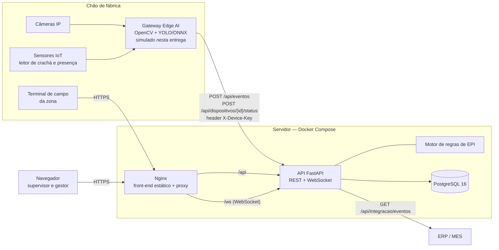
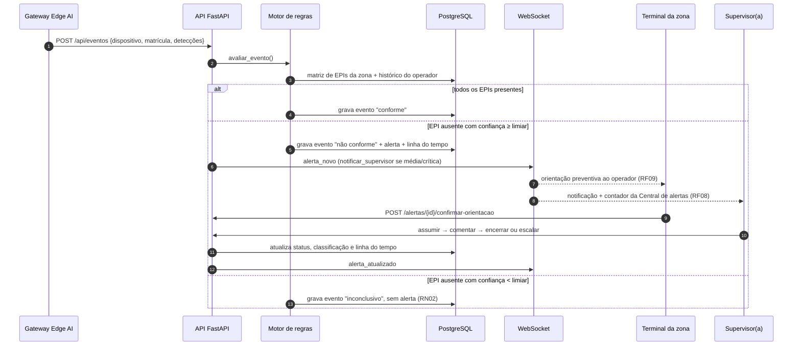
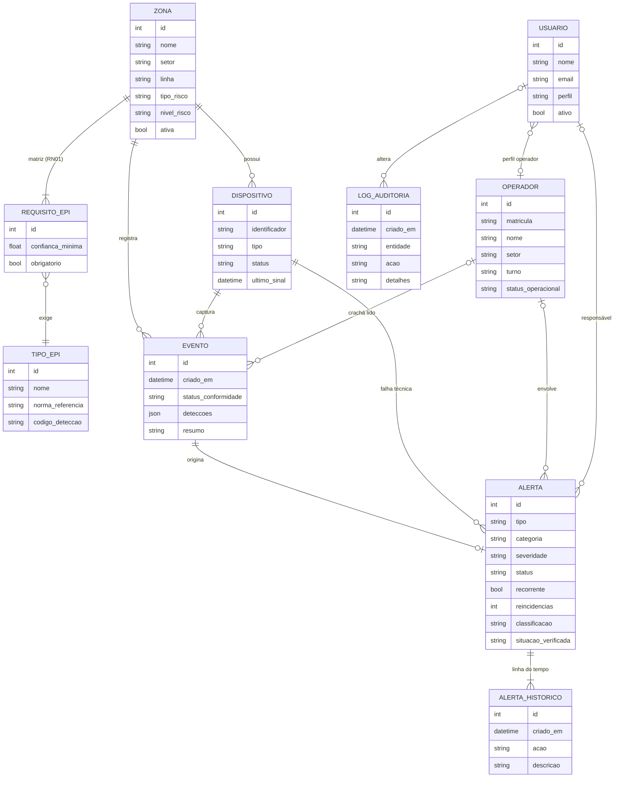

# Arquitetura final — MetaSafe EPI (Sprint 4)

Este documento consolida a arquitetura da solução entregue na Sprint 4 e registra as decisões técnicas tomadas ao longo das quatro Sprints. Os requisitos citados (RF, RNF, RN, RS) estão em [requisitos.md](requisitos.md).

## 1. Visão geral

O MetaSafe EPI é um sistema web de segurança industrial com três camadas: **borda** (câmeras, sensores e gateway Edge AI), **servidor** (API, motor de regras e banco) e **interfaces** (painel do supervisor/gestor e terminal de campo do operador).



**Princípios mantidos desde a Sprint 1**

- O vídeo é processado na borda; o servidor só recebe eventos estruturados (RNF02, RS07).
- A identificação usa matrícula/crachá e zona — nunca reconhecimento facial (RNF06).
- O sistema orienta e documenta; nenhuma advertência é gerada automaticamente (RN06).
- Falha de equipamento gera alerta técnico, nunca alerta contra o operador (RN07).

## 2. Componentes

| Componente | Pasta | Responsabilidade |
| --- | --- | --- |
| Interface web | `frontend/` | SPA em React + TypeScript. Telas do protótipo da Sprint 2 e da Sprint 3, reaproveitando o CSS do protótipo. Mantém uma conexão WebSocket para atualizar telas e notificar o supervisor. |
| Nginx | `frontend/nginx.conf` | Serve o build estático e encaminha `/api`, `/ws` e `/docs` para a API. Com isso, front e API ficam na mesma origem (sem CORS em produção). |
| API | `backend/app/main.py`, `routers/` | Autenticação JWT, rotas REST por domínio, WebSocket `/ws/alertas`, documentação Swagger em `/docs`. |
| Motor de regras | `backend/app/regras.py` | Implementa o diagrama de atividades da Sprint 1: compara detecções com a matriz da zona, aplica limiar de confiança, calcula severidade, trata reincidência e recorrência e registra a linha do tempo. |
| Banco | PostgreSQL (Docker) / SQLite (modo local) | Persistência de cadastros, eventos, alertas, histórico e auditoria. |
| Distribuição em tempo real | `backend/app/realtime.py` | Hub que envia `evento`, `alerta_novo`, `alerta_atualizado` e `dispositivo` a todos os clientes conectados. |
| Simulador Edge AI | `edge-simulator/simulador.py` e `POST /api/simulador/*` | Representa o gateway de borda: gera leituras de câmera no mesmo formato que o gateway real enviaria. |
| Dados simulados | `backend/app/seed.py` | 40 dias de operação da Planta SP da Metaindústria, gerados passando cada evento pelo motor de regras real. |

## 3. Fluxo principal: do evento ao encerramento



### Regras aplicadas pelo motor

| Regra | Implementação |
| --- | --- |
| Matriz por zona (RN01) | Cada `ZonaOperacional` tem `RequisitoEPI` com EPI, limiar mínimo de confiança e flag de obrigatoriedade. A API recusa zona sem EPI obrigatório. |
| Limiar de confiança (RN02, RF14) | Ausência só gera alerta se a confiança da detecção for maior ou igual ao limiar do EPI naquela zona. Abaixo disso, o evento fica "inconclusivo". |
| Severidade | Base pelo nível de risco da zona (médio → baixa, alto → média, crítico → média). Sobe um nível se faltar EPI crítico (capacete, luvas isolantes, máscara de solda, respirador) e outro se o caso for recorrente. |
| Notificação do supervisor (RF08, RN03) | Alertas de severidade média ou crítica disparam notificação imediata; severidade baixa só orienta o operador. |
| Reincidência | Nova detecção do mesmo problema, do mesmo operador, em até 10 minutos reforça o alerta aberto (contador de reincidências) em vez de abrir outro; a partir da segunda reincidência a severidade sobe. |
| Recorrência (RN05) | Se o operador já teve 2 ou mais alertas comportamentais nos 7 dias anteriores (excluindo falsos positivos), o novo alerta é marcado como recorrente, tem severidade elevada e a orientação sugere conversa com a supervisão. |
| Encerramento (RN04) | Só supervisor ou gestor encerram ou escalam. Não é possível encerrar com "Risco ainda presente": a interface e a API exigem escalonamento. |
| Falha técnica (RF16, RN07) | `offline`/`degradado` cria um alerta `FALHA_DISPOSITIVO` (código `TEC-`), sem operador, sem duplicar enquanto houver um pendente. |

## 4. Modelo de dados

Baseado no diagrama de classes da Sprint 1 ([diagramas/classes.md](diagramas/classes.md)), com as adaptações listadas na seção 7.



## 5. API

Documentação interativa completa em `http://localhost:8000/docs` (Swagger gerado pelo FastAPI).

| Grupo | Endpoints principais | Perfis |
| --- | --- | --- |
| Autenticação | `POST /api/auth/login`, `GET /api/auth/me` | todos |
| Ingestão Edge AI | `POST /api/eventos`, `POST /api/dispositivos/{identificador}/status` | dispositivo (`X-Device-Key`) ou supervisor |
| Monitoramento | `GET /api/monitoramento`, `GET /api/eventos`, `GET /api/dispositivos` | supervisor, gestor |
| Simulador | `POST /api/simulador/evento`, `POST /api/simulador/dispositivos/{id}` | supervisor |
| Alertas | `GET /api/alertas`, `GET /api/alertas/resumo`, `GET /api/alertas/{id}`, `GET /api/alertas/exportar.csv` | supervisor, gestor |
| Tratamento | `POST /api/alertas/{id}/assumir`, `/comentarios`, `/encerrar`, `/escalar` | supervisor, gestor (RN04) |
| Terminal | `GET /api/terminal/{zona_id}`, `POST /api/alertas/{id}/confirmar-orientacao` | todos |
| Operadores | `GET/POST /api/operadores`, `GET/PUT /api/operadores/{id}` | leitura: supervisor e gestor · escrita: supervisor |
| Zonas e regras | `GET/POST /api/zonas`, `GET/PUT /api/zonas/{id}`, `GET/POST /api/tipos-epi`, `GET /api/auditoria` | leitura: todos · escrita: supervisor |
| Indicadores | `GET /api/dashboard`, `GET /api/relatorios/conformidade(.csv)` | supervisor, gestor |
| Integração | `GET /api/integracao/eventos?desde=&formato=json\|csv` | supervisor, gestor |
| Tempo real | `WS /ws/alertas?token=<JWT>` | todos |

**Contrato do evento enviado pelo gateway**

```json
POST /api/eventos
X-Device-Key: <chave do dispositivo>

{
  "dispositivo": "CAM-LM02-A",
  "matricula": "OP-1842",
  "deteccoes": [
    { "epi": "capacete", "presente": true,  "confianca": 0.97 },
    { "epi": "oculos",   "presente": false, "confianca": 0.96 }
  ]
}
```

## 6. Segurança e LGPD

- **Autenticação:** JWT (HS256) com expiração configurável; senhas com PBKDF2-SHA256 (200 mil iterações, sal por usuário).
- **Autorização por perfil (RF01):** operador acessa só o terminal; gestor tem leitura de regras e pode encerrar ocorrências (RN04); supervisor tem acesso completo.
- **Dispositivos:** o gateway se autentica com `X-Device-Key` própria, separada das credenciais de usuários.
- **Minimização de dados (RNF05, RS07):** nenhuma imagem é armazenada; a evidência é a lista de EPIs com a confiança de cada detecção. A tela mostra um quadro anonimizado.
- **Relatórios consolidados (RN08):** relatórios, CSV de ocorrências e integração ERP/MES usam matrícula, nunca o nome do operador.
- **Auditoria (RNF07):** toda ação sobre um alerta entra na linha do tempo; cadastros e alterações de regra entram no log de auditoria com "antes" e "depois".
- **Configuração:** segredos por variável de ambiente (`JWT_SECRET`, `EDGE_API_KEY`); os valores padrão servem só para desenvolvimento.

## 7. Decisões técnicas ao longo das Sprints

| # | Sprint | Decisão | Justificativa |
| --- | --- | --- | --- |
| D1 | 1 | Processar vídeo no edge e enviar só eventos estruturados | Menor latência, independência da rede e privacidade (RNF02, RS07). |
| D2 | 1 | Identificar por crachá, não por rosto | Privacidade e aceitação pelos operadores (RNF06). |
| D3 | 1 | Stack React + TypeScript, Python + FastAPI, PostgreSQL, WebSocket, Docker, JWT | Python aproxima API e visão computacional; FastAPI oferece REST e WebSocket nativos; PostgreSQL atende histórico e relatórios. Mantida na entrega final. |
| D4 | 1 | Estoque, compra e distribuição de EPIs fora do escopo | O foco é a conformidade de uso por zona. Mantido na Sprint 4: "registros de EPIs" são o catálogo de tipos com norma e a matriz por zona, além das detecções. |
| D5 | 2 | Protótipo navegável em HTML/CSS/JS com as três personas | Validar fluxos antes do código. A Sprint 4 reaproveita o CSS e a estrutura de telas do protótipo, garantindo aderência ao que foi aprovado. |
| D6 | 3 | Separar Central de Alertas, Detalhe da Ocorrência e Histórico | Refinamento do fluxo de tratamento; viraram as telas `/alertas`, `/alertas/:id` e `/historico`. |
| D7 | 3 | Fluxo câmera → edge → API → regra → alerta → WebSocket → supervisor → tratamento → banco → relatórios | Implementado exatamente nessa ordem (seção 3). |
| D8 | 4 | `AlertaRisco` e `OcorrenciaSeguranca` unidos na tabela `alertas` | A relação é 1 : 0..1 e o tratamento sempre acontece sobre o alerta; uma tabela simplifica consultas e a linha do tempo. |
| D9 | 4 | `DeteccaoEPI` gravada como JSON no evento | As detecções são lidas sempre junto com o evento; evita uma tabela com milhões de linhas sem consulta própria. |
| D10 | 4 | `CameraIP` e `SensorIoT` como uma entidade `Dispositivo` com campo `tipo` | Mesmo ciclo de vida e mesmo controle de saúde (RF16). |
| D11 | 4 | Ingestão do edge por HTTP com chave de dispositivo, MQTT adiado | Menos infraestrutura para o avaliador; o contrato de evento é o mesmo e o broker MQTT pode ser colocado na frente sem mudar o motor de regras. |
| D12 | 4 | Simulador de eventos na interface e em script | Permite demonstrar o fluxo completo sem câmeras, usando o mesmo motor de regras da produção. |
| D13 | 4 | Dados simulados gerados pelo próprio motor de regras | Histórico de alertas, reincidências e recorrências coerente com as regras, em vez de números inventados. |
| D14 | 4 | Recorrência = 2 ou mais alertas nos 7 dias anteriores; reincidência = mesma falha em até 10 min | Separa esquecimento pontual de padrão recorrente (RN05) sem inflar alertas quando a câmera vê a mesma pessoa várias vezes. |
| D15 | 4 | SQLite automático quando não há `DATABASE_URL` | O avaliador consegue rodar sem Docker e sem instalar banco. |
| D16 | 4 | Front-end servido pelo Nginx com proxy para a API | Mesma origem para REST e WebSocket, sem configurar CORS. |
| D17 | 4 | Exportação PDF pela impressão do navegador com estilo próprio | Atende RF13 sem dependência pesada de geração de PDF no servidor. |

## 8. Requisitos não funcionais

| RNF | Situação na entrega |
| --- | --- |
| RNF01 — alerta crítico em até 5 s | Atendido: o alerta é publicado via WebSocket na mesma requisição que recebe o evento (teste `test_websocket_recebe_alerta`). |
| RNF02 — processamento no edge | Atendido pela arquitetura; o gateway real é simulado. |
| RNF03 — disponibilidade 99,5% | Depende da implantação; contêineres com healthcheck e reinício pelo Compose. |
| RNF04 — modo degradado | Fora desta entrega (responsabilidade do gateway de borda). |
| RNF05 — LGPD | Atendido: minimização, controle de acesso, sem imagens, relatórios sem nomes. |
| RNF06 — sem reconhecimento facial | Atendido: identificação por matrícula/crachá. |
| RNF07 — auditoria | Atendido: linha do tempo por alerta e log de auditoria de cadastros e regras. |
| RNF08 — interface industrial simples | Atendido: CSS do protótipo, mensagens curtas, terminal com botões grandes. |
| RNF09 — escalabilidade | Zonas, dispositivos e matrizes são configuráveis; API sem estado (o hub de WebSocket precisaria de Redis/pub-sub para várias instâncias). |
| RNF10 — integração REST, MQTT e CSV | REST e CSV atendidos; MQTT previsto (D11). |
| RNF11 — saúde de câmeras, sensores e API | Atendido na tela de Monitoramento e em `/api/health`; Prometheus/Grafana ficam para a implantação. |
| RNF12 — backups | Volume do PostgreSQL persistente; rotina de backup fica para a implantação. |

## 9. Execução e configuração

| Variável | Padrão | Uso |
| --- | --- | --- |
| `DATABASE_URL` | `sqlite:///./metasafe.db` | No Compose: `postgresql+psycopg://metasafe:metasafe@db:5432/metasafe` |
| `JWT_SECRET` | valor de desenvolvimento | Troque em produção |
| `JWT_EXP_MINUTES` | `480` | Duração da sessão (um turno) |
| `EDGE_API_KEY` | `edge-dev-key` | Chave do gateway Edge AI |
| `SEED_ON_STARTUP` | `true` | Popula o banco vazio com os dados simulados |
| `APP_TIMEZONE` | `America/Sao_Paulo` | Fuso da planta para turnos e relatórios |

Serviços do `docker-compose.yml`: `db` (PostgreSQL 16), `api` (FastAPI, porta 8000), `web` (Nginx + React, porta 8080) e `edge` (simulador, perfil opcional `--profile edge`).
